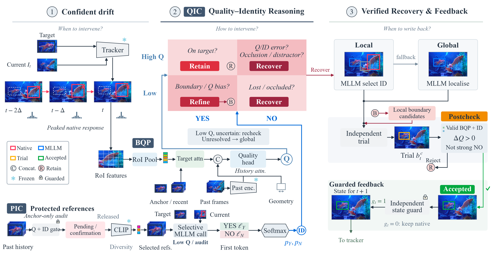
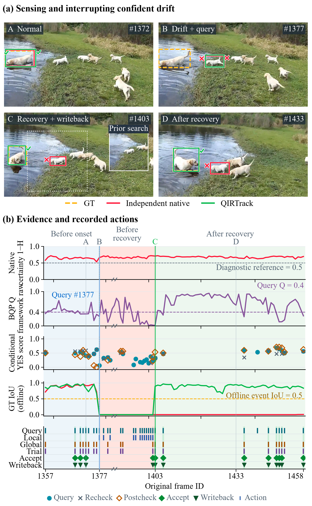
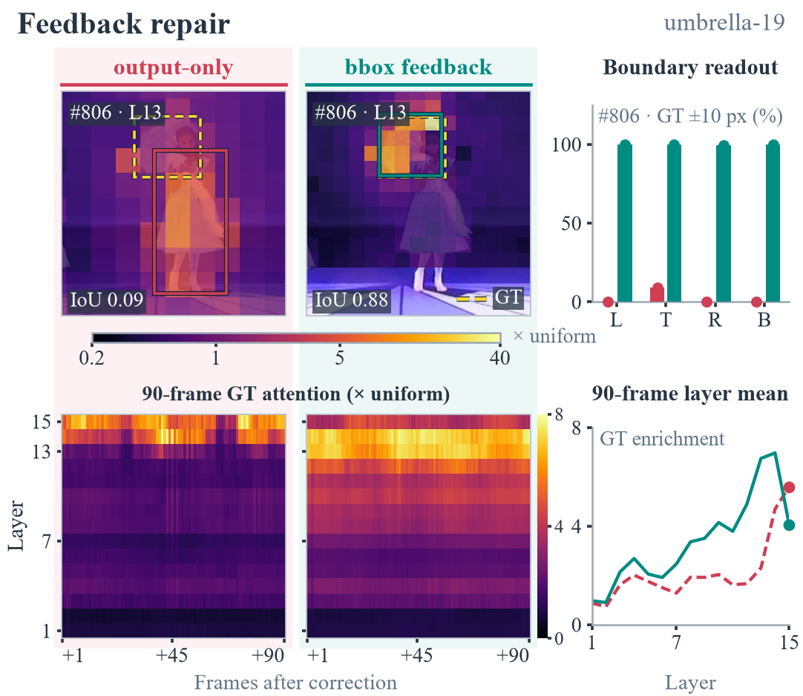

# QIRTrack

**Quality–Identity Routing for Single Object Tracking**

[Installation](docs/INSTALL.md) · [Quickstart](docs/QUICKSTART.md) · [Model Zoo](docs/MODEL_ZOO.md) · [Online Tracking](docs/ONLINE_TRACKING.md)

A tracker can remain confident while persistently mislocalising its target. QIRTrack addresses this failure mode, **confident drift**, by checking localisation quality and target identity separately. It uses a multimodal large language model (MLLM) selectively and verifies proposed corrections before accepting them.

## Framework

- **Bounding Box Quality Predictor (BQP)** estimates the quality of boxes already supplied by the tracker or recovery trial. It uses target-conditioned visual features, past observations and box geometry to help decide when to query; it does not predict a second tracking trajectory.
- **Quadrant-based Intervention Controller (QIC)** uses quality and semantic identity evidence to choose whether to retain, refine or recover a box. For recovery, the MLLM provides identity evidence or a coarse proposal; an isolated tracker trial and candidate postcheck validate the correction.
- **Protected Identity Codebook (PIC)** maintains diverse, screened references for later identity checks. Accepting a corrected output and writing that correction back to the tracker are separate decisions.

## Qualitative examples

**Detecting and interrupting drift (`dog-19`, LaSOT).** The native tracker stays confident after switching to a distractor. The timeline aligns the quality estimate, semantic queries and verified recovery with the two tracking trajectories.

Inspect the tracker after a correction (umbrella-19)

This case compares output-only correction with bounding-box feedback from the same correction point. The panels show subsequent attention and boundary readout; they illustrate one sequence, not an aggregate performance result.

## Get started

Tracker adapters are provided separately for [ARTrackV2](lib/trackers/artrackv2/), [OSTrack](lib/trackers/ostrack/) and [SUTrack](lib/trackers/sutrack/). The shared QIRTrack components are under [`lib/models/qirtrack/`](lib/models/qirtrack/).

1. Follow the [installation instructions](docs/INSTALL.md). The [Model Zoo](docs/MODEL_ZOO.md) identifies the matching native tracker profiles and lists the available predictor checkpoint.
2. Use the [Quickstart](docs/QUICKSTART.md) for configuration, offline predictor evaluation and legacy S9 fine-tuning. Check the installation with `python tracking/preflight.py --offline`.
3. To run the full tracker on ordered image frames with a first-frame box, follow the [online tracking guide](docs/ONLINE_TRACKING.md) and run `python tracking/test.py` with the generated configuration. The online path requires a configured MLLM backend and user-supplied prompts.

## Weights and release scope

[Download legacy S9 (Google Drive, restricted access)](https://drive.google.com/file/d/1JjT9JF8ryTl1RcfIy_sV0NMC0oBHGSXI/view) · [Placement and checksum](docs/MODEL_ZOO.md)

This is trained with ARTrackV2-Base256-seq-GOT, which is **not the final benchmark checkpoint**. Native tracker weights are provided by their upstream projects.

See [reproducibility](docs/REPRODUCIBILITY.md) and [release scope](docs/RELEASE_SCOPE.md) for the qualified workflows and limitations. Please note that we made some changes to the code and retrained the model after submitting this code repository, thus the repository code is not the final version of the paper.

## Acknowledgements and licensing

The repository builds on [ARTrackV2](https://github.com/MIV-XJTU/ARTrack), [OSTrack](https://github.com/botaoye/OSTrack) and [SUTrack](https://github.com/chenxin-dlut/SUTrack). [Third-party notices](docs/THIRD_PARTY.md) are retained. A licence for the original QIRTrack code has not yet been selected. See [CITATION.cff](CITATION.cff) for citation status.
